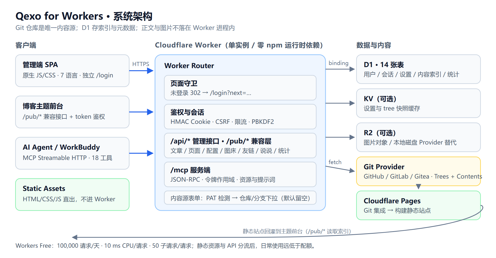
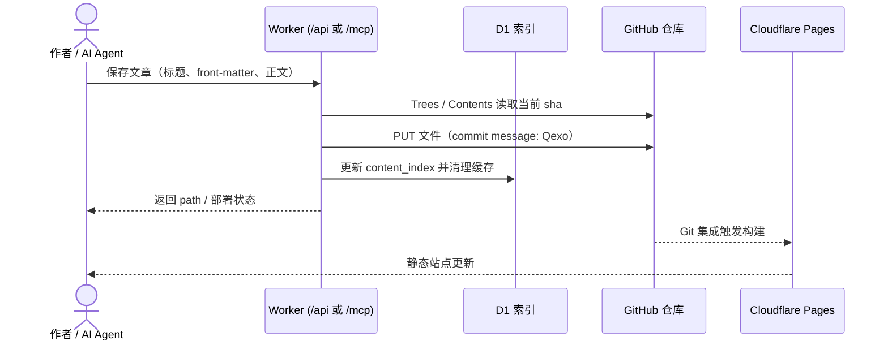
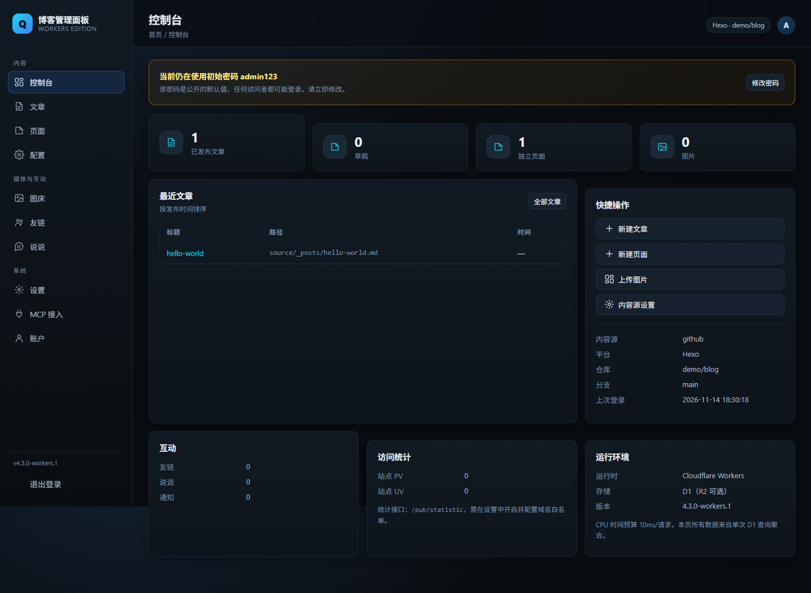
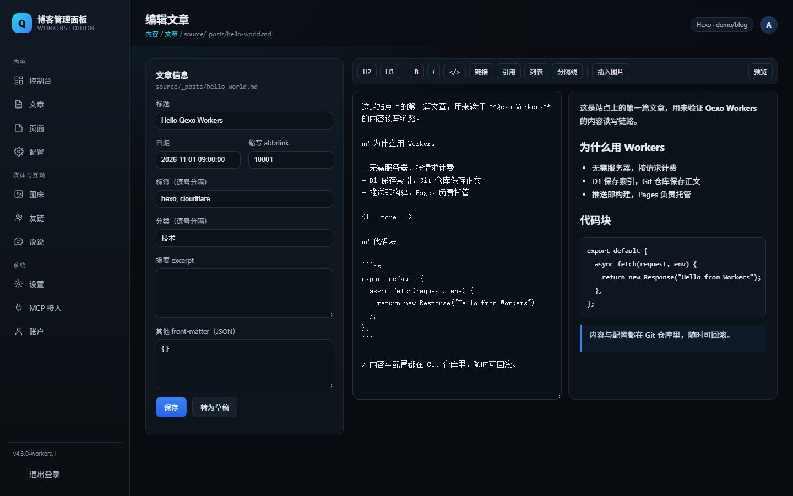
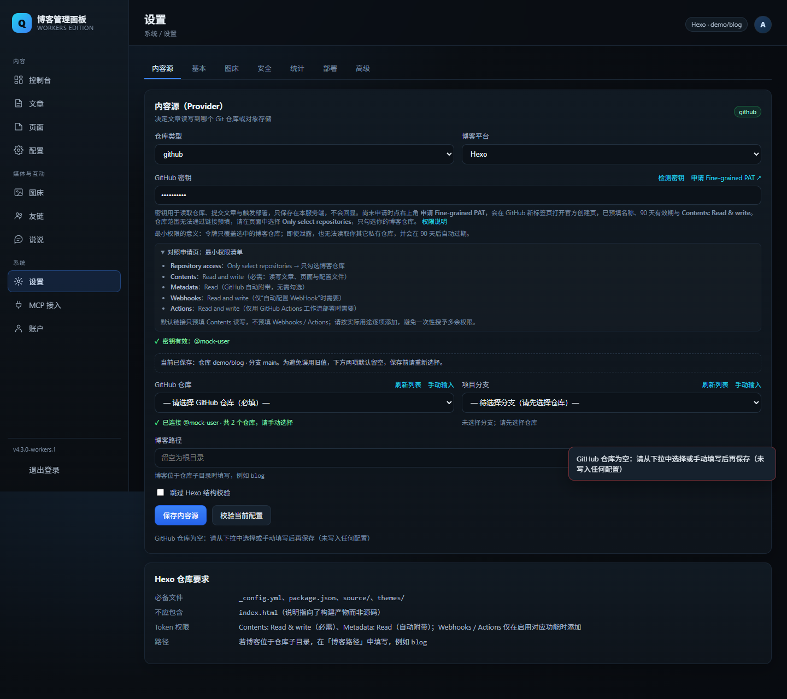
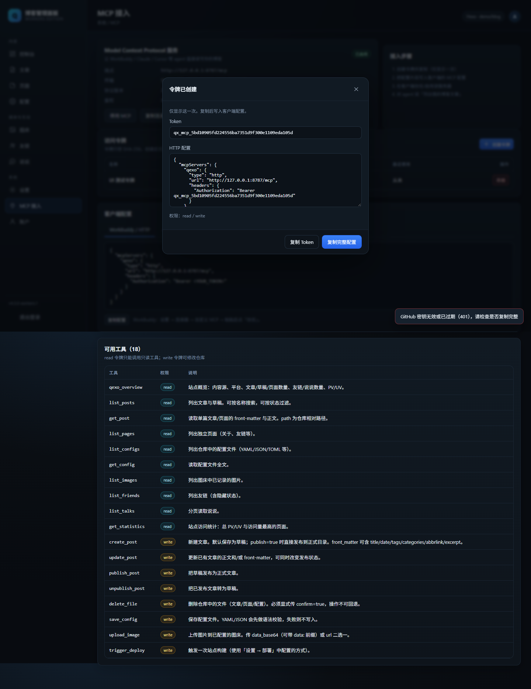
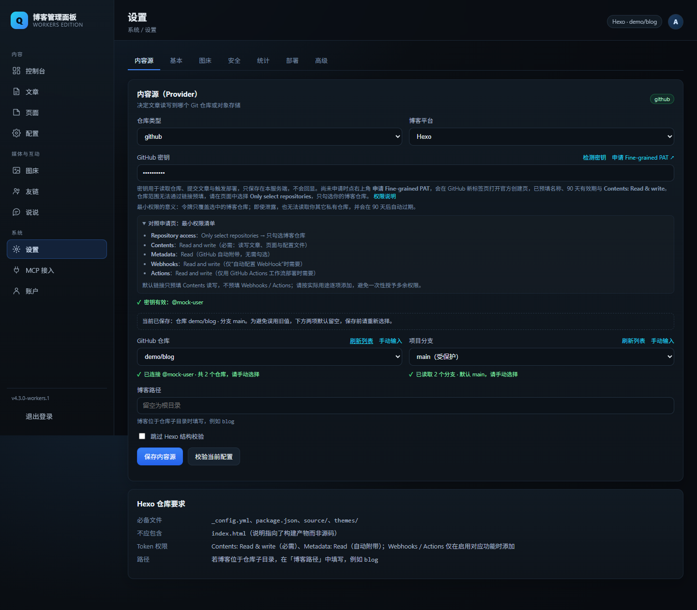

# Qexo for Workers

**把 Django 版 Qexo 重写为 Cloudflare Workers 原生博客管理后台**

[](LICENSE)
[](https://workers.cloudflare.com/)
[](https://www.typescriptlang.org/)
[](docs/test-report.md)
[](docs/test-report.md)
[](docs/mcp.md)
[](package.json)
[](https://workers.cloudflare.com/)

---

> 无服务器、无容器、零运行时 npm 依赖；Git 仓库仍是唯一内容源，前台主题无需改动即可复用 `/pub/*` 接口。

## 目录

- [1. 项目简介](#1-项目简介)
- [2. 功能特性](#2-功能特性)
- [3. 快速开始（本地）](#3-快速开始本地)
- [4. 部署与配置](#4-部署与配置)
- [5. 使用示例](#5-使用示例)
- [6. 测试与验收](#6-测试与验收)
- [7. 注意事项与已知边界](#7-注意事项与已知边界)
- [8. 文档索引](#8-文档索引)
- [9. 许可证与致谢](#9-许可证与致谢)

---

## 1. 项目简介

[Qexo](https://github.com/Qexo/Qexo) 是基于 Django 的 Hexo/Hugo 博客管理后台。本仓库把它重写为 **Cloudflare Workers 原生应用**：单个 Worker 承载管理 API、公开兼容接口与 MCP 服务端，管理端是原生 JS/CSS 的单页应用，元数据落 D1，图片落 R2，正文仍提交到 Git 仓库。

| 项 | 值 |
|---|---|
| 项目版本 | **1.5.0**（`package.json` 与运行时 `/api/me` 一致） |
| 上游版本 | Qexo 4.3.0（GPL-3.0） |
| 运行时 | Workers + Static Assets（启动约 7–9 ms） |
| 数据层 | D1（14 张表）＋ KV（可选缓存）＋ R2（可选图片/内容） |
| 内容源 | GitHub / GitLab / Gitea / R2；Hexo、Hugo、Valaxy、VuePress、VitePress、Nuxt、Astro 七套目录配置 |
| 依赖 | 运行时 **0** 个 npm 包；构建期仅 `wrangler`、`typescript`、`esbuild`、`yaml` |
| 代码规模 | 约 8.6 千行 TypeScript / JS / CSS；生产包 470.85 KiB（gzip 100.11 KiB） |

### 1.1 架构图



可编辑矢量源文件：[docs/assets/architecture.svg](docs/assets/architecture.svg)

### 1.2 为什么这样设计

Workers Free 的硬约束决定了架构，而不是简单地把 Django 代码翻译一遍：

| 约束 | 应对设计 |
|---|---|
| 无 Python、无常驻进程、无本地磁盘 | 全部逻辑重写为 TypeScript；本地磁盘 Provider 映射为 R2 |
| 10 ms CPU / 请求、50 子请求 / 请求 | GitHub Trees API 一次拉全量目录；blob sha 复用，保存一篇文章仅 1–2 次 Git 调用 |
| D1 免费额度 500 万行读 / 10 万行写 / 天 | 内容索引落 D1，列表与搜索零 Git 调用；设置 15 s 内存缓存 |
| KV 免费仅 1,000 写 / 天 | 不依赖 KV；缺失时自动退回 D1 `cache` 表 |
| 静态资源计费 | 管理端 HTML/CSS/JS 由 Assets 直出，只有 `/api/*`、`/pub/*`、`/mcp` 消耗 Worker 请求 |
| Git 出口 IP 共享匿名配额 | 内容源强制使用 Fine-grained PAT；健康检查在配置时即验证 |

### 1.3 内容写入链路



---

## 2. 功能特性

### 2.1 管理后台

| 分组 | 能力 |
|---|---|
| 内容 | 文章 / 草稿 / 页面 CRUD、front-matter 可视化编辑、Markdown 预览、abbrlink（crc16/crc32 复刻）、重命名、发布与转草稿 |
| 配置 | `_config.yml` 等在线编辑、YAML/JSON 合法性校验、7 种博客平台目录映射、自定义字段 |
| 媒体 | 图床上传 / 列表 / 删除（R2、GitHub、GitHub 内容源、S3、Custom），长缓存读取 |
| 互动 | 友链与前台申请、说说发布与点赞、PV/UV 统计与域名白名单、站内通知 |
| 系统 | 4 步初始化向导、8 组设置（含「外观」面板风格切换）、导入导出备份、缓存清理、WebHook 自动配置、部署触发（Pages / Vercel / Actions / 自定义） |
| 国际化 | 7 种语言词典，由脚本从上游 Python 字典原样导出 |

### 2.2 接口与协议

| 分组 | 说明 |
|---|---|
| 管理 API | 41 个接口，含 `/api/set_hexo` 等旧路径别名，路径与字段尽量保持 Qexo 语义 |
| 主题兼容层 | 25 个 `/pub/*` 接口，token 鉴权与返回结构不变，现有 Hexo 主题可直接使用 |
| MCP（AI Agent） | `POST /mcp` Streamable HTTP，18 个工具（10 只读 + 8 写入）、资源与提示词、read/write 令牌作用域 |
| Agent 一键接入提示词 | 创建令牌时同步生成自包含 Markdown 提示词（令牌 / 端点 / 配置 / 工具 / 适配 / 排错），可原样发给任意 AI agent |
| stdio 桥接 | `mcp/stdio-bridge.mjs` 让只支持 stdio 的客户端也能接入 |

### 2.3 安全

- 密码：PBKDF2-SHA256，100,000 次迭代 + 随机盐；会话 Cookie 为 `HttpOnly + SameSite=Lax + HMAC 签名`。
- 请求：写操作强制 `X-CSRF-Token`；登录 10 次/10 分钟/IP 限流；友链申请 5 次/小时/IP。
- 页面守卫：未登录访问 `/` 由 Worker 直接 302 到 `/login?next=…`，SPA 启动与 API 401 双重兜底；回跳路径做同源白名单校验。
- 凭据：Provider / 图床 token 一律掩码回显；MCP 令牌与 WebHook APIKey 只存 SHA-256，可单独吊销。「GitHub 内容源」图床不另存密钥，直接复用内容源配置。
- 内容源：默认引导申请 **Fine-grained PAT**，只授权单个博客仓库与 `Contents: Read and write`。
- 登录人机验证：**设置 → 安全** 页提供 **Cloudflare Turnstile** 开关（默认关闭，状态、前置条件与实际生效状态均可见）与三项连接配置输入框；切换与保存均即时生效。三项配置（`TURNSTILE_SITE_KEY` / `TURNSTILE_SECRET` / `TURNSTILE_HOSTNAMES`）可直接在本页填写，也可由部署环境变量提供，**环境变量优先**；网页填写的值存 D1 `settings` 表并掩码回显（密钥只写不读，设置接口与「高级」页均不出现明文），要求更高隔离时仍可用 `wrangler secret put`。仅当前置条件齐备且开关开启时，登录页才渲染 widget，服务端在 `/api/auth` 前置 canonical siteverify（校验 `success` / `action=login` / hostname 白名单）；浏览器只取 token，不调用 siteverify。开关旁的「如何启用」在当前页面内以浮层展示完整步骤，不跳转外部站点。配置步骤见 `docs/deploy.md`。

### 2.4 界面预览

| 控制台 | 文章编辑器 |
|:---:|:---:|
|  |  |

| 内容源配置 | MCP 接入页 |
|:---:|:---:|
|  |  |

完整功能对照（36 项：29 项原生、5 项等价替代、2 项平台不可行）见 [`docs/migration-mapping.md`](docs/migration-mapping.md)。

---

## 3. 快速开始（本地）

**前置条件**：Node.js ≥ 20、npm、Wrangler 4（随 devDependencies 安装）；浏览器 UI 测试另需本机 Edge/Chrome。

```bash
git clone https://github.com/tq4meishijia/qexo4workers.git
cd qexo4workers
npm install
npm run db:local       # 应用 D1 迁移到本地 SQLite
npm run dev            # http://127.0.0.1:8787
```

首次启动自动创建管理员 **`admin` / `admin123`** 与独立登录页 `/login`。登录后进入剩余初始化步骤（内容源 → 部署方式）；控制台在密码仍为默认值时持续显示警示条。

```bash
npm test               # API e2e：56 项（自动拉起 mock GitHub + wrangler dev）
npm run test:ui        # 浏览器 UI：13 项
npm run deploy:dry     # 生产构建试运行，不上传
```

> 本地 `wrangler.toml` 使用 `local-dev` 占位资源 ID 并绑定 R2 用于测试；线上请使用 `wrangler.prod.toml`。

---

## 4. 部署与配置

### 4.1 创建云资源

```bash
npx wrangler login
npx wrangler d1 create qexo                 # 记下 database_id
npx wrangler kv namespace create qexo-cache # 可选，记下 id
npx wrangler r2 bucket create qexo-images   # 需先在控制台开通 R2
```

把返回的 ID 填入 `wrangler.prod.toml` 的 `[[d1_databases]]` 与 `[[kv_namespaces]]`。若账号**未开通 R2**（API 返回 10042），删除 `[[r2_buckets]]` 段落即可，图床改用 GitHub / S3 / Custom。

### 4.2 部署

```bash
npm run db:remote       # 生产 D1 执行迁移
npm run deploy          # wrangler deploy --config wrangler.prod.toml
npm run test:prod       # 线上 API 冒烟
node test/prod-ui.mjs   # 线上浏览器冒烟
```

会话密钥建议用 `wrangler secret put SESSION_SECRET` 固定；未设置时应用会在首次登录时自动生成 32 字节密钥并写入 D1，功能不受影响。

### 4.3 配置文件与环境变量

| 文件 / 变量 | 用途 |
|---|---|
| `wrangler.toml` | 本地开发：占位 D1/KV ID + R2 绑定，`run_worker_first` 让 `/`、`/login` 先过 Worker 守卫 |
| `wrangler.prod.toml` | 生产：真实资源 ID，与本地配置分离 |
| `PUBLIC_ORIGIN` | 自定义域名，用于生成 R2 图片绝对地址与回跳 |
| `GITHUB_API_BASE` | 测试时指向 mock GitHub；生产留空即 `https://api.github.com` |
| `SESSION_SECRET` | 会话签名密钥（Secret，不放配置文件） |
| `.dev.vars` | 本地密钥，已在 `.gitignore` 中忽略 |

### 4.4 首次配置内容源

1. 用初始账号登录 → **设置 → 内容源**。
2. 点击 **「申请 Fine-grained PAT ↗」**：新标签页打开 GitHub 创建页，已预填 `Qexo Workers` 名称、90 天有效期与 `Contents: Read and write`。
3. 在 GitHub 页面把 `Repository access` 设为 `Only select repositories` 并只勾选博客仓库（GitHub 不支持 URL 预填仓库范围），生成后粘贴回表单。
4. 点 **「检测密钥」**：自动读取该令牌可访问的仓库；选中仓库后加载分支列表。
5. 逐项明确选择仓库与分支，保存；点 **「刷新索引」** 拉取文章。

| 字段 | 说明 |
|---|---|
| 仓库类型 | `github` / `gitlab` / `gitea` / `r2` |
| 博客平台 | `Hexo`（默认）/ `Hugo` / `Valaxy` / `VuePress` / `VitePress` / `Nuxt` / `Astro` |
| token | Fine-grained PAT；最小权限为 `Contents: Read and write` + 自动的 `Metadata: Read` |
| repo / branch | **自动回填已保存值**：重开配置页即可看到当前仓库与分支；未配置时保持「必填 / 待选择」占位，清空后保存仍被前后端拦截 |
| path | 博客在仓库子目录时填写，例如 `blog` |

> 最小权限：令牌仅覆盖一个仓库，泄露时无法读取其它私有仓库，且 90 天后失效。仅在启用自动 WebHook 时加 `Webhooks`，仅在 Actions 部署时加 `Actions`；不要改用 classic token 的 `repo` scope。

### 4.5 站点构建（Pages）

Pages 项目连接的是**博客源码仓库**（不是本仓库），构建命令 `npm install && npx hexo generate`，输出目录 `public`。也可在后台配置 Deploy Hook / Actions `workflow_dispatch`，保存内容后由 Worker 触发。完整步骤与故障排查见 [`docs/deploy.md`](docs/deploy.md)。

---

## 5. 使用示例

### 5.1 后台写文章

登录后进入 **文章 → 新建**，填写标题、标签、分类与正文，右侧实时预览；点「保存草稿」写入 `source/_drafts/`，点「发布」移动到 `source/_posts/`。保存会触发一次 Git commit，若配置了部署钩子则同时触发构建。



### 5.2 REST API

```bash
BASE="${QEXO_BASE_URL:-https://qexo.example.com}"

# 1) 登录，保存会话 Cookie
curl -s -c cookies.txt -X POST "$BASE/api/auth" \
  -H 'Content-Type: application/json' \
  -d '{"username":"admin","password":"<你的密码>"}'

# 2) 取 CSRF 与当前状态
curl -s -b cookies.txt "$BASE/api/me" | jq '{user, csrf, init}'

# 3) 新建文章（写操作必须带 X-CSRF-Token）
curl -s -b cookies.txt -X POST "$BASE/api/save_post" \
  -H 'Content-Type: application/json' \
  -H 'X-CSRF-Token: <上一步的 csrf>' \
  -d '{
    "file": "hello-from-api",
    "content": "## 来自 API 的正文\n",
    "front_matter": {"title": "Hello API", "tags": ["workers"]},
    "status": "true"
  }'

# 4) 主题侧公开接口
curl -s "$BASE/pub/friends"
```

### 5.3 接入 WorkBuddy / 其它 AI Agent

**推荐：一键接入提示词。** 在后台 **MCP 接入** 创建令牌后，弹窗会自动生成一段可直接发给任意 AI agent 的 Markdown 提示词，点「复制 Agent 配置提示词」即可。它自包含以下内容，agent 无需追问即可完成配置：

- 明文令牌、端点 URL、传输与协议版本、当前作用域；
- 标准 `mcpServers` HTTP 配置（含 `type` / `url` / `headers`）；
- 客户端适配规则：`servers` 键名、`transport` 字段、stdio 桥接配置、纯 HTTP JSON-RPC 回退；
- 18 个工具的功能清单（按 read/write 分组）、使用说明与首条验证指令；
- 安全警告、401/403/429 排错与完成回执要求。

提示词固定 6 段结构，配置块均为可直接解析的 JSON；令牌只在连接信息与标准配置中出现两次，其余示例用 `$QEXO_MCP_TOKEN` 占位。规范详见 [`docs/mcp.md`](docs/mcp.md) 第 3.4 节。令牌明文只在创建时显示一次，请妥善保管。

也可以只复制 HTTP 配置片段，手工写入 `~/.workbuddy/mcp.json`：

```json
{
  "mcpServers": {
    "qexo": {
      "type": "http",
      "url": "https://qexo.example.com/mcp",
      "headers": { "Authorization": "Bearer qx_mcp_xxx" }
    }
  }
}
```

保存后在「连接器 → 自定义 MCP」点信任。常用工具：`qexo_overview`、`list_posts`、`get_post`、`create_post`、`update_post`、`publish_post`、`save_config`、`upload_image`、`trigger_deploy`。只读令牌调用写工具会返回带原因的 `isError` 结果；`delete_file` 必须传 `confirm: true`。仅支持 stdio 的客户端改用 `mcp/stdio-bridge.mjs`。详见 [`docs/mcp.md`](docs/mcp.md)。

### 5.4 目录结构

```text
src/
  index.ts          路由、中间件、页面守卫、旧接口别名
  lib.ts            HTTP / 加密 / Cookie / Router / 响应信封
  auth.ts           会话、CSRF、PBKDF2、限流、reCAPTCHA
  store.ts          设置缓存、D1 cache、i18n
  platforms.ts      7 种博客平台目录配置
  vcs.ts            GitHub / GitLab / Gitea / R2 Provider
  github.ts         PAT 健康检查、授权仓库与分支枚举
  content.ts        文章/页面/配置领域逻辑、front-matter、CRC
  images.ts         R2 / GitHub / GitHub 内容源 / S3(SigV4) / Custom 图床
  api-app.ts        管理 API
  api-public.ts     /pub 兼容层
  mcp.ts            MCP 服务端（JSON-RPC / 工具 / 资源 / 令牌）
  ui/               管理端 SPA（原生 JS/CSS，7 语言词典）
    js/style-library.js  面板风格库：主题集中配置、Cookie 持久化、默认回退（head 同步加载）
    js/mcp-prompt.js  Agent 配置提示词生成器（纯函数，Node 可直接单测）
mcp/stdio-bridge.mjs   stdio → HTTP 桥接
migrations/        D1 schema
docs/              调研、部署、迁移映射、配额、MCP、测试报告、交接
test/              mock GitHub、e2e、UI 冒烟、Hexo 站点 fixture
```

---

## 6. 测试与验收

| 套件 | 命令 | 结果 |
|---|---|---|
| API 端到端 | `npm test` | **58/58** |
| 浏览器 UI | `npm run test:ui` | **18/18**（含按钮组件规范 / 风格切换 / Cookie 恢复 / 无效值回退） |
| 线上 API 冒烟 | `QEXO_BASE_URL=<部署地址> npm run test:prod` | **15/15**（0 跳过） |
| 线上浏览器 | `QEXO_BASE_URL=<部署地址> node test/prod-ui.mjs` | **7/7** |
| 生产构建 | `npm run deploy:dry` | 470.85 KiB / gzip 100.11 KiB |

线上测试的目标地址只从命令行参数或环境变量 `QEXO_BASE_URL` 读取（默认 `https://qexo.example.com` 占位符），仓库内不保存真实部署地址。

测试以真实目录模拟 Git 仓库、用构建脚本模拟 Pages 的「检出 → 构建」链路，覆盖初始化、登录守卫（含 Turnstile 独立套件 `node test/turnstile.mjs` 与网页配置/环境变量优先级）、文章落盘与回滚、配置校验、图床（含内容源图床的目录/前缀优先级）、友链、说说、统计、WebHook、备份、MCP 握手与越权拒绝、PAT 检测与空值表单。详见 [`docs/test-report.md`](docs/test-report.md)。

---

## 7. 注意事项与已知边界

> [!IMPORTANT]
> 初始密码 `admin123` 是公开值，仅用于首次接管。**部署到公网后请立即在「账户」页修改**；建议同时用 Cloudflare Access 保护 `/` 与 `/api/*`。

| # | 事项 | 说明 |
|---|---|---|
| 1 | GitHub PAT 必填 | Workers 出口 IP 与其它租户共享 GitHub 匿名配额（60 次/小时/IP），公开仓库只读也会被 403；线上必须配 PAT |
| 2 | R2 可选 | 账号未开通 R2（API 10042）时不要绑定；开通后在 `wrangler.prod.toml` 加回 `[[r2_buckets]]` 并重新部署 |
| 3 | Pages 真实构建 | 本地 `test/build-site.mjs` 是 Hexo 的等价简化实现，不渲染主题；上线前用真实 `hexo generate` 验证 |
| 4 | Passkey | 应用层未内置 WebAuthn，替代方案为 Cloudflare Access 的 Passkey / OTP 策略 |
| 5 | 平台不可行项 | 本地磁盘 Provider → R2；FTP / 又拍 / Doge 图床（需 TCP）、云端 Python 脚本执行无对应能力，见迁移矩阵 |
| 6 | 密钥保管 | 线上凭据文件（`test/out/deploy-credentials.txt`）已被 `.gitignore` 忽略，切勿提交；生产 Secret 用 `wrangler secret put` 管理 |
| 7 | MCP 协议版本 | 以 2025-06-18 握手为基线，兼容 2025-03-26 / 2024-11-05；2026-07-28 的 `_meta` 新模型未实现 |
| 8 | 已保存值回填与空值拦截 | 内容源表单自动回填已保存的仓库与分支；清空任一字段后保存会被前后端明确拦截，不会静默沿用旧配置 |
| 9 | 免费额度 | 按日更 1–3 篇、日均 PV 5,000 估算余量 10 倍以上；瓶颈是 Pages 500 次构建/月，见 `docs/quota-analysis.md` |
| 10 | 生产配置含资源 ID | `wrangler.prod.toml` 带当前账号的 D1 / KV 标识，fork 后请替换成自己的；该文件**不含任何凭据**，`SESSION_SECRET` 与 PAT 均不入库 |
| 11 | 内容源图床前缀 | 「GitHub 内容源」默认写入内容源仓库 `img-qexo` 目录、访问前缀为 GitHub 原始 raw；下拉可切换 jsDelivr 等公共 CDN，自定义 http(s) 前缀合法时优先级最高，非法时回退下拉；公共 CDN 属于第三方服务，可用性不由本项目保证 |
| 12 | Turnstile 启用条件 | `TURNSTILE_SITE_KEY`（公开值）、`TURNSTILE_SECRET`、`TURNSTILE_HOSTNAMES` 三项齐备（网页填写或环境变量，环境变量优先），**且**在「设置 → 安全」打开开关，才会实际生效；开关默认关闭，页面内显示前置条件、配置来源与实际生效状态。网页填写的密钥存 D1 并掩码回显、只写不读；要求更高隔离可改用 `wrangler secret put`（值不可读回）。缺任一条件则保持原有登录/reCAPTCHA 路径。生产 hostname 白名单不得包含 localhost / 127.0.0.1，密钥绝不写入仓库或聊天 |

---

## 8. 文档索引

| 文档 | 内容 |
|---|---|
| [`docs/deploy.md`](docs/deploy.md) | 资源创建、Pages、Access、故障排查 |
| [`docs/mcp.md`](docs/mcp.md) | MCP 端点、令牌、WorkBuddy / Claude 配置、工具目录 |
| [`docs/handoff.md`](docs/handoff.md) | 交接背景、进展、待办、已知问题、维护建议 |
| [`docs/test-report.md`](docs/test-report.md) | 验收环境、用例、线上验证记录、证据 |
| [`docs/migration-mapping.md`](docs/migration-mapping.md) | 与上游 Qexo 的 36 项功能对照 |
| [`docs/quota-analysis.md`](docs/quota-analysis.md) | 单操作成本与免费额度推算 |
| [`docs/research-cloudflare.md`](docs/research-cloudflare.md) | Workers / D1 / KV / R2 / Pages 官方限额 |
| [`docs/qexo-inventory.md`](docs/qexo-inventory.md) | 上游 15,544 行源码的功能与路由清单 |

---

## 9. 许可证与致谢

本项目是对 [Qexo](https://github.com/Qexo/Qexo) 的衍生重写，遵循 **GPL-3.0-or-later**（见 [`LICENSE`](LICENSE)）。上游版权归 Qexo 作者 **abudu** 及贡献者所有；Cloudflare Workers、D1、R2、Pages 为 Cloudflare 产品。

---

Made with TypeScript + Cloudflare Workers · **v1.5.0** · 2026-11
